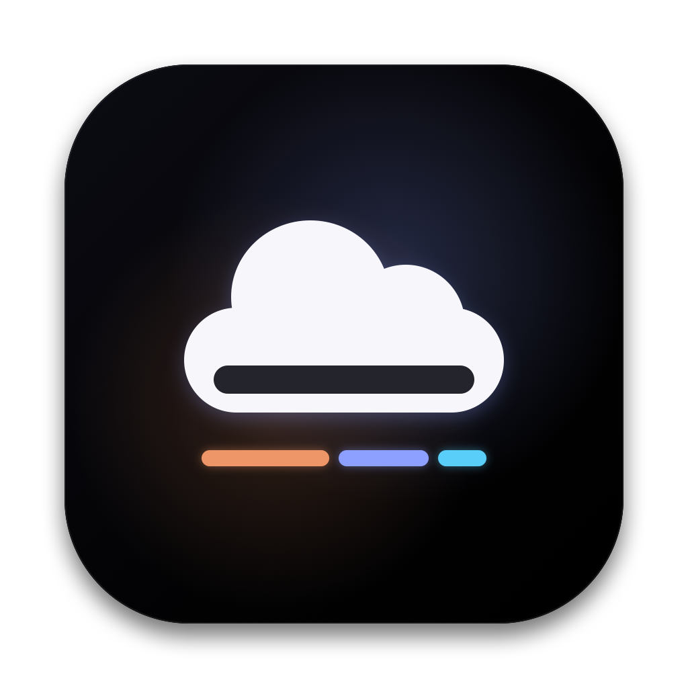

<p align="center">
  
</p>

<h1 align="center">Stratus</h1>

<p align="center">
  <strong>A fast, minimal, pitch-black native macOS desktop console for Google Cloud Platform.</strong><br />
  Built directly on Google Cloud REST APIs with SwiftUI, Swift Charts, and zero external dependencies.
</p>

<p align="center">
  
  
  
  
</p>

---

## Design Philosophy

Google Cloud's web console is dense, nested, and slow to navigate. **Stratus** strips away chrome and visual noise in favor of a calm, keyboard-first workspace:

- **Pure Pitch Black (`#000000`)**: Seamless dark canvas extending into a transparent macOS titlebar.
- **Zero Pane Dividers & Zero Card Borders**: Navigation, content, and inspector drawers are separated purely by whitespace, typographic hierarchy, and subtle tonal elevation (`#060608` / `#111114`).
- **Tabular Telemetry**: Monospace tabular figures (`monospacedDigit`) for spend, vCPUs, IP addresses, request counts, and timestamps.
- **Instant Exploration**: Ships with an offline **Demo Mode** so you can explore the full interface before connecting a live project.

---

## Features

| Section | Capabilities |
| :--- | :--- |
| **Overview** | Hero total spend KPI, service cost breakdown, interactive 30-day `.monotone` spline area chart with hover crosshair, `Totals` metric strip, segmented category/service bars, and clickable `Top resources` grid. |
| **Compute Engine** | Aggregated VM inventory across zones, Running/Stopped filters, internal & external IPs, inline **Start / Stop / Reset**, and one-click `gcloud compute ssh` copy. |
| **Cloud Run** | Service list with readiness indicators, clickable `.run.app` URLs, inline traffic split bars, scaling/resource specs, and full revision history drawer. |
| **Cloud Storage** | Borderless bucket & folder browser with clickable breadcrumbs, inline text/JSON/YAML preview, **Upload** (`NSOpenPanel`), **Download** (`NSSavePanel`), and **Delete**. |
| **Data & Secrets** | **BigQuery** dataset/table explorer + SQL query runner; **Cloud SQL** instance inventory & restart; **Secret Manager** version browser with masked-by-default payload reveal. |
| **Cloud Logging** | Monospace log stream with severity pills (`ERR`, `WRN`, `INF`, `DBG`), Cloud Logging filter queries, and expandable `jsonPayload` inspection. |
| **IAM & APIs** | Role-to-principal policy viewer (`roles/*`) and Service Usage API search with **Enable / Disable** controls. |
| **Command Palette (`⌘K`)** | Fuzzy jump across projects, VMs, Cloud Run services, GCS buckets, sections, and connection settings. |

---

## Authentication & Security

Stratus communicates directly with official `*.googleapis.com` REST endpoints and **never** bundles API keys, client secrets, or telemetry trackers:

1. **Local `gcloud` CLI / ADC (Recommended)**
   Auto-detects `gcloud` in `/opt/homebrew/bin/gcloud`, `/usr/local/bin/gcloud`, or `~/google-cloud-sdk/bin/gcloud`, reading short-lived tokens via `gcloud auth print-access-token` or Application Default Credentials.
2. **Native Google OAuth 2.0 (PKCE)**
   Uses `ASWebAuthenticationSession` with SHA-256 PKCE (`com.stratus.gcp:/oauth2redirect`). Access & refresh tokens are stored strictly in your **macOS Keychain** (`com.stratus.gcp`).
3. **Bearer Token / Demo Mode**
   Paste a temporary `ya29...` token into Keychain or toggle offline Demo Mode anytime from the bottom-left account pill.

---

## Installation & Build

### Requirements
- macOS 14.0+ (Sonoma or newer)
- Xcode / Swift 6.0+ toolchain

### Package & Install to `~/Applications`

```bash
# Run unit tests
swift test

# Build release binary, generate .app bundle with icon, and install to ~/Applications
./scripts/build-app.sh --release --install

# Launch Stratus
open ~/Applications/Stratus.app
```

Or run directly during development:

```bash
swift run
```

*(To regenerate `Assets/AppIcon.png` and `Assets/AppIcon.icns`, run `swift scripts/generate-icon.swift`.)*

---

## Agent Integration (`agy` & `fairy`)

Stratus ships with a built-in **MCP stdio server** (`--mcp`), a **JSON CLI** (`stratus`), and **`stratus://` deep-link navigation** so Antigravity (`agy`) and Fairy (Claude Code, Codex, and Gemini) can inspect and operate Google Cloud resources on your behalf.

### Install Agent Integrations

After installing `~/Applications/Stratus.app`, run:

```bash
./scripts/install-agent-integrations.sh
```

This configures:
- **CLI**: Symlinks `~/.local/bin/stratus` → `~/Applications/Stratus.app/Contents/MacOS/Stratus`
- **MCP Server (`--mcp`)**: Registers `stratus` in Antigravity (`agy mcp add`), Claude Code/Fairy (`~/.claude.json`), and Codex/Fairy (`~/.codex/config.toml`)
- **Agent Skill**: Installs `.agents/skills/stratus/SKILL.md` to `~/.gemini/config/skills/stratus/`, `~/.claude/skills/stratus/`, and `~/.codex/skills/stratus/`

### Available MCP Tools & CLI Commands

| MCP Tool | CLI Equivalent | Purpose |
| :--- | :--- | :--- |
| `stratus_status` | `stratus status` | Auth mode, active email, default project |
| `stratus_list_projects` | `stratus projects` | List accessible GCP projects |
| `stratus_overview` | `stratus overview` | Cost & resource summary |
| `stratus_list_vms` / `stratus_vm_action` | `stratus vm list\|start\|stop\|reset` | Inspect & control Compute VMs |
| `stratus_list_cloud_run` | `stratus run list` | List Cloud Run services & URLs |
| `stratus_list_buckets` / `stratus_list_objects` / `stratus_read_object` | `stratus storage buckets\|ls\|cat` | Browse & read GCS objects |
| `stratus_query_logs` | `stratus logs --filter "..."` | Query Cloud Logging |
| `stratus_list_iam` / `stratus_list_apis` / `stratus_toggle_api` | `stratus iam` / `stratus apis ...` | Inspect IAM & toggle GCP APIs |
| `stratus_bigquery` / `stratus_cloud_sql` / `stratus_secrets` | `stratus bq\|sql\|secrets ...` | Query BigQuery, Cloud SQL & Secret Manager |
| `stratus_open_ui` | `stratus open [section]` | Focus the Stratus macOS app via `stratus://` |

---

## Keyboard Shortcuts

| Shortcut | Action |
| :--- | :--- |
| `⌘K` | Open Command Palette |
| `⌘J` | Toggle In-App Agent Drawer (Fairy / Antigravity) |
| `⌘R` | Refresh active view |
| `⌘1` – `⌘7` | Jump to Overview, Compute, Cloud Run, Storage, Data & Secrets, Logs, or IAM & APIs |
| `⌘\` | Toggle sidebar |
| `Esc` | Close Command Palette, Agent Drawer, or Inspector drawer |

---

## Project Structure

```text
.
├── Assets/
│   ├── AppIcon.icns
│   └── AppIcon.png
├── Package.swift
├── scripts/
│   ├── build-app.sh          # Compiles, bundles Stratus.app, and optionally installs to ~/Applications
│   └── generate-icon.swift   # Renders 1024x1024 icon & compiles AppIcon.icns
├── Sources/Stratus/
│   ├── Models/               # Sendable GCP resource & billing models
│   ├── Services/             # AuthManager (PKCE + gcloud), KeychainStore, GCPAPIClient, CostEstimator, DemoDataProvider
│   ├── State/                # @MainActor @Observable AppState
│   ├── Theme/                # Pitch-black T3 tokens & zero-border SwiftUI components
│   ├── Views/                # Overview, Compute, Cloud Run, Storage, Data & Secrets, Logging, IAM, Inspector, Palette
│   └── StratusApp.swift
└── Tests/StratusTests/       # Unit tests for PKCE, GCS encoding, REST JSON decoding & cost estimation
```
